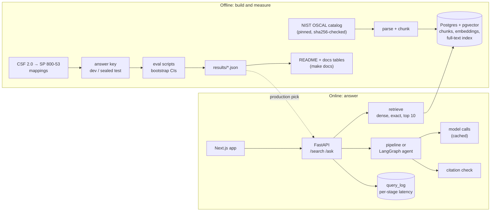
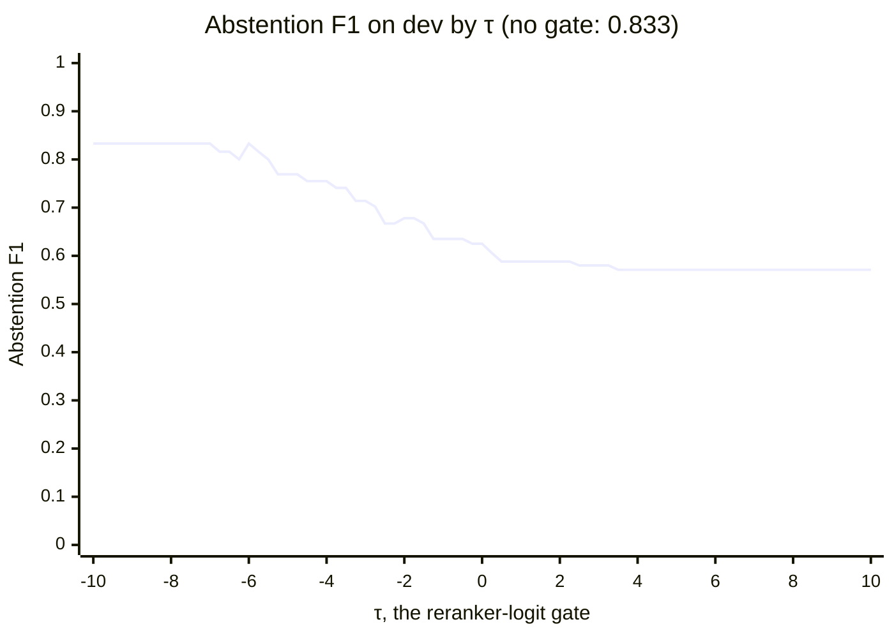
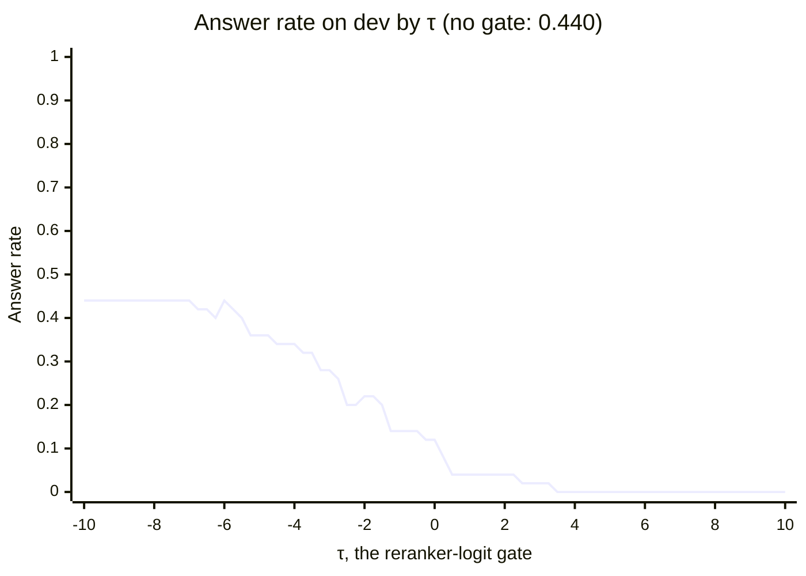

# ControlFinder

ControlFinder answers questions about NIST SP 800-53 Rev 5 with citations to the controls it used, and refuses
when the evidence isn't there. Every retrieval and answering choice was measured against an answer key on a dev
split, with 95% confidence intervals, and then checked once on a sealed test split.

## Why it can be measured

Most RAG demos are never measured. This one has a free, authoritative answer key. NIST publishes official
mappings from **CSF 2.0 subcategories to SP 800-53 controls** (the CSF 2.0 Informative References). Each CSF
subcategory, and each of its implementation examples, becomes a query, and the controls NIST maps it to become
the right answers. So retrieval is scored with recall@k, MRR and nDCG instead of by eyeballing outputs. For the
answering step, a hand-labelled set of questions (some answerable from SP 800-53, some not) scores whether the
system answers or refuses, and whether its citations hold up.

## Architecture



## Results

Every table and chart below is generated by `make docs` from `results/*.json`.
`tests/test_docs_generated.py` fails if any of them is out of date.

What the one test run showed:

- **Retrieval held up.** Production retrieval (dense, row 2) scored the same recall@10 on test as on dev, and
  every dev decision kept its direction. Dense beat BM25, with intervals that exclude zero on both splits.
  Hybrid's small edge over dense stayed inside the noise, so the simpler dense search stays. The reranker
  **hurt** on every metric compared, on both splits, and it was by far the slowest retrieval stage.
- **Base text still helped, by less.** On test it turned two of the pipeline's refusals on answerable questions
  into correct answers and changed nothing else, so its interval touches zero.
- **The agent didn't help, so it ran on dev only.** It gave the pipeline's answers word for word, with an extra
  model call (the scope check) on most questions.
- **Some checks disagree with dev, as expected by chance.** Each one is explained in
  [docs/learn/06](docs/learn/06-final-test-ci-api.md).

### Retrieval: every setup, dev beside the one test run

<!-- BEGIN generated: final_retrieval -->
| Setup | Retrieval | Chunking | Rerank | recall@10 dev (338 queries) [95% CI] | recall@10 test (131 queries) [95% CI] | Production |
|---|---|---|---|---|---|---|
| Phase 2 `fts_and` | `fts_and` | C_separate | no | 0.008 [0.001, 0.018] | 0.002 [0.000, 0.005] |  |
| Phase 2 `fts_or` | `fts_or` | C_separate | no | 0.309 [0.261, 0.360] | 0.343 [0.251, 0.448] |  |
| Phase 2 `bm25` | `bm25` | C_separate | no | 0.372 [0.317, 0.433] | 0.361 [0.292, 0.447] |  |
| Phase 2 `dense` | `dense` | C_separate | no | 0.420 [0.363, 0.479] | 0.421 [0.340, 0.513] |  |
| Phase 3 row 1 | `bm25` | C_separate | no | 0.372 [0.317, 0.433] | 0.361 [0.292, 0.447] |  |
| Phase 3 row 2 | `dense` | C_separate | no | 0.420 [0.363, 0.479] | 0.421 [0.340, 0.513] | **yes** |
| Phase 3 row 3 | `hybrid` | C_separate | no | 0.436 [0.378, 0.497] | 0.436 [0.359, 0.525] |  |
| Phase 3 row 4 | `hybrid` | C_separate | yes | 0.345 [0.299, 0.398] | 0.325 [0.275, 0.387] |  |
| Phase 3 row 5 | `hybrid` | A_control_only | yes | 0.362 [0.311, 0.420] | 0.337 [0.286, 0.400] |  |
| Phase 3 row 6 | `hybrid` | B_control_plus_enh | yes | 0.378 [0.322, 0.437] | 0.343 [0.284, 0.416] |  |
<!-- END generated: final_retrieval -->

The paired differences that chose the setup, with test beside dev:

<!-- BEGIN generated: final_comparisons -->
| Difference, all queries | Metric | Dev [95% CI] | Test [95% CI] | Dev CI excludes 0 | Test CI excludes 0 |
|---|---|---|---|---|---|
| `fts_or` − `fts_and` | recall@10 | +0.300 [+0.255, +0.353] | +0.341 [+0.249, +0.446] | yes | yes |
| `bm25` − `fts_or` | recall@10 | +0.063 [+0.013, +0.116] | +0.018 [-0.064, +0.103] | yes | no |
| `dense` − `bm25` | recall@10 | +0.049 [+0.017, +0.081] | +0.060 [+0.006, +0.119] | yes | yes |
| hybrid vs best single retriever (row 3 − row 2) | recall@10 | +0.016 [-0.003, +0.036] | +0.015 [-0.021, +0.051] | no | no |
| reranker vs no reranker (row 4 − row 3) | recall@10 | -0.091 [-0.124, -0.061] | -0.111 [-0.175, -0.055] | yes | yes |
| reranker vs no reranker (row 4 − row 3) | ndcg@10 | -0.084 [-0.118, -0.057] | -0.113 [-0.166, -0.062] | yes | yes |
| reranker vs no reranker (row 4 − row 3) | mrr | -0.082 [-0.135, -0.038] | -0.153 [-0.234, -0.071] | yes | yes |
| reranker vs no reranker (row 4 − row 3) | precision@5 | -0.064 [-0.087, -0.043] | -0.052 [-0.084, -0.018] | yes | yes |
| best chunking vs runner-up (row 6 − row 5) | recall@10 | +0.015 [-0.004, +0.035] | +0.006 [-0.030, +0.046] | no | no |
| production (row 2) − row 1 | recall@10 | not computed on dev | +0.060 [+0.006, +0.119] | – | yes |
| production (row 2) − row 3 | recall@10 | -0.016 [-0.036, +0.003] | -0.015 [-0.051, +0.021] | no | no |
| production (row 2) − row 4 | recall@10 | not computed on dev | +0.096 [+0.035, +0.172] | – | yes |
| production (row 2) − row 5 | recall@10 | not computed on dev | +0.085 [+0.026, +0.148] | – | yes |
| production (row 2) − row 6 | recall@10 | not computed on dev | +0.078 [+0.029, +0.138] | – | yes |
<!-- END generated: final_comparisons -->

### The evidence threshold τ (dev only)

The agent can refuse when the reranker's best score for the retrieved evidence is below τ. The rule for picking
τ was written down before the sweep: the highest dev abstention F1, with ties going to the lowest τ, and "no
gate" counting as the lowest of all.

<!-- BEGIN generated: threshold_chart -->



<!-- END generated: threshold_chart -->

### Answering: agent vs pipeline

<!-- BEGIN generated: final_generation -->
| System | `abstention_f1` dev | `abstention_f1` test | `answer_rate` dev | `answer_rate` test | `answer_accuracy` dev | `answer_accuracy` test |
|---|---|---|---|---|---|---|
| Pipeline | 0.833 [0.703, 0.927] | 0.909 [0.800, 0.979] | 0.440 [0.300, 0.580] | 0.520 [0.380, 0.660] | 0.909 [0.773, 1.000] | 1.000 [1.000, 1.000] |
| Pipeline + base text | 0.952 [0.865, 1.000] | 0.952 [0.865, 1.000] | 0.560 [0.420, 0.700] | 0.560 [0.420, 0.700] | 0.929 [0.821, 1.000] | 1.000 [1.000, 1.000] |
| Agent | 0.833 [0.703, 0.927] | not run (dev only) | 0.440 [0.300, 0.580] | not run (dev only) | 0.909 [0.773, 1.000] | not run (dev only) |
<!-- END generated: final_generation -->

<!-- BEGIN generated: final_versus -->
| Metric | Base text − pipeline, dev [95% CI] | Base text − pipeline, test [95% CI] | Agent − pipeline, dev [95% CI] | Agent − pipeline, test |
|---|---|---|---|---|
| `abstention_f1` | +0.119 [+0.040, +0.219] | +0.043 [+0.000, +0.116] | +0.000 [+0.000, +0.000] | not run |
| `answer_rate` | +0.120 [+0.040, +0.220] | +0.040 [+0.000, +0.100] | +0.000 [+0.000, +0.000] | not run |
| `answer_accuracy` | +0.019 [+0.000, +0.061] | +0.000 [+0.000, +0.000] | +0.000 [+0.000, +0.000] | not run |
<!-- END generated: final_versus -->

What base text changed, question by question, on test:

<!-- BEGIN generated: final_decision_moves -->
| Test questions | Change from the pipeline | Pipeline + base text |
|---|---|---|
| answerable | refused → answered | 2 |
| answerable | answered → refused | 0 |
| unanswerable | refused → answered | 0 |
| unanswerable | answered → refused | 0 |
<!-- END generated: final_decision_moves -->

On dev, the pairwise comparison of the agent and the pipeline, on the questions both answered:

<!-- BEGIN generated: pairwise_results -->
| Both answered | Identical answers (ties, not judged) | Agent wins | Pipeline wins | Ties | Orders disagreed | Unreadable verdicts |
|---|---|---|---|---|---|---|
| 22 | 22 | 0 | 0 | 22 | 0 | 0 |
<!-- END generated: pairwise_results -->

### Where test disagrees with dev

The rule, fixed before the test run: a test result differs noticeably from dev when the dev point estimate
falls outside the test 95% interval. Each one is discussed in
[docs/learn/06](docs/learn/06-final-test-ci-api.md).

<!-- BEGIN generated: final_shifts -->
35 of 346 checks have the dev point estimate outside its test 95% interval:

| What | Metric | Queries | Dev | Test [95% CI] | Test is |
|---|---|---|---|---|---|
| `fts_and` | recall@5 | subcat | 0.031 | 0.003 [0.000, 0.009] | lower |
| `fts_and` | recall@10 | subcat | 0.031 | 0.003 [0.000, 0.009] | lower |
| `fts_and` | recall@20 | subcat | 0.031 | 0.003 [0.000, 0.009] | lower |
| `fts_and` | norm_recall@5 | subcat | 0.035 | 0.006 [0.000, 0.019] | lower |
| `fts_and` | norm_recall@10 | subcat | 0.032 | 0.003 [0.000, 0.010] | lower |
| `fts_and` | norm_recall@20 | subcat | 0.031 | 0.003 [0.000, 0.009] | lower |
| `fts_and` | ndcg@10 | subcat | 0.035 | 0.007 [0.000, 0.021] | lower |
| `fts_and` | recall@5 | all | 0.008 | 0.002 [0.000, 0.005] | lower |
| `fts_and` | recall@10 | all | 0.008 | 0.002 [0.000, 0.005] | lower |
| `fts_and` | recall@20 | all | 0.008 | 0.002 [0.000, 0.005] | lower |
| `fts_and` | norm_recall@10 | all | 0.009 | 0.002 [0.000, 0.006] | lower |
| `fts_and` | norm_recall@20 | all | 0.008 | 0.002 [0.000, 0.005] | lower |
| `fts_or` | recall@20 | subcat | 0.526 | 0.658 [0.556, 0.769] | higher |
| `fts_or` | norm_recall@20 | subcat | 0.538 | 0.658 [0.556, 0.769] | higher |
| `dense` | norm_recall@5 | example | 0.352 | 0.280 [0.221, 0.345] | lower |
| `dense` | norm_recall@5 | all | 0.377 | 0.318 [0.258, 0.377] | lower |
| row 2 | norm_recall@5 | example | 0.352 | 0.280 [0.221, 0.345] | lower |
| row 2 | norm_recall@5 | all | 0.377 | 0.318 [0.258, 0.377] | lower |
| row 4 | ndcg@10 | subcat | 0.377 | 0.288 [0.223, 0.363] | lower |
| row 5 | norm_recall@5 | subcat | 0.369 | 0.254 [0.177, 0.348] | lower |
| row 6 | recall@5 | subcat | 0.339 | 0.242 [0.170, 0.329] | lower |
| row 6 | norm_recall@5 | subcat | 0.408 | 0.285 [0.198, 0.379] | lower |
| row 6 | ndcg@10 | subcat | 0.392 | 0.309 [0.237, 0.390] | lower |
| row 6 | recall@5 | example | 0.248 | 0.179 [0.131, 0.230] | lower |
| row 6 | norm_recall@5 | example | 0.315 | 0.235 [0.173, 0.300] | lower |
| row 6 | recall@5 | all | 0.268 | 0.194 [0.153, 0.244] | lower |
| row 6 | norm_recall@5 | all | 0.336 | 0.247 [0.192, 0.304] | lower |
| row 4 − row 3 | recall@10 | subcat | -0.114 | -0.235 [-0.347, -0.129] | lower |
| row 4 − row 3 | ndcg@10 | subcat | -0.122 | -0.215 [-0.301, -0.131] | lower |
| Pipeline | gold_citation_recall | QA | 0.864 | 0.962 [0.900, 1.000] | higher |
| Pipeline | answer_accuracy | QA | 0.909 | 1.000 [1.000, 1.000] | higher |
| Pipeline + base text | answer_accuracy | QA | 0.929 | 1.000 [1.000, 1.000] | higher |
| Pipeline + base text − pipeline | abstention_f1 | QA | +0.119 | +0.043 [+0.000, +0.116] | lower |
| Pipeline + base text − pipeline | answer_rate | QA | +0.120 | +0.040 [+0.000, +0.100] | lower |
| Pipeline + base text − pipeline | answer_accuracy | QA | +0.019 | +0.000 [+0.000, +0.000] | lower |
<!-- END generated: final_shifts -->

### Latency

<!-- BEGIN generated: final_costs -->
| Latency (ms) | Dev | Test |
|---|---|---|
| Row 1 (bm25), p50 | 1.6 | 1.8 |
| Row 2 (dense), p50 | 2.6 | 2.9 |
| Row 3 (hybrid), p50 | 4.3 | 4.6 |
| Row 4 (hybrid, reranked), p50 | 4.4 + 1,661 rerank | 4.5 + 1,696 rerank |
| Row 5 (hybrid, reranked), p50 | 2.6 + 1,791 rerank | 2.8 + 1,832 rerank |
| Row 6 (hybrid, reranked), p50 | 2.5 + 2,127 rerank | 2.7 + 2,129 rerank |
| Pipeline: retrieval + generation, p50 / p95 | 9,559 / 13,675 | 11,101 / 100,506 |
| Pipeline + base text: retrieval + generation, p50 / p95 | 10,207 / 14,468 | 11,584 / 36,144 |
<!-- END generated: final_costs -->

Reranked rows show first-stage retrieval plus the reranker's model time, and no row includes embedding the
query. Test generation latency includes the provider trouble that interrupted the run (see
[DECISIONS.md](DECISIONS.md)), so its p95 says more about the provider that day than about the system.

## Decisions and why

Every decision, the alternatives and the evidence are in [DECISIONS.md](DECISIONS.md). Each phase has a
walkthrough in [docs/learn/](docs/learn/).

## Limitations

- **The answer key isn't exhaustive.** NIST maps each CSF subcategory to some relevant controls, not all of
  them. A retrieved control missing from the key may still be right, so precision is a lower bound.
- **The eval sets are small** (see the query and question counts in the tables), which is why every number
  carries a 95% bootstrap interval, and why many differences can't be told apart.
- **The corpus is one catalog** (sizes in [docs/learn/01](docs/learn/01-data-chunking.md)). Exact vector
  search is fast at this size, so this project says nothing about tuning approximate search at web scale.
- **One person labelled the QA set**, including which questions are unanswerable. There is no second labeller
  and no agreement score.
- **Citations are checked for presence, not support.** The check confirms that each cited control was in the
  model's context and that one of them is in the answer key. It doesn't check that the cited control supports
  the sentence it is attached to.
- **The faithfulness judge didn't discriminate.** It is a different model family from the generator, to avoid
  self-preference, but it gave every dev answer the top score, so faithfulness doesn't separate the systems. It
  and the agent ran on dev only, to stay within a model-call budget.
- **The prompts are wrapped.** Model calls go through the Cursor SDK, which adds its own instructions around
  ours, so the exact text the model sees isn't fully under this project's control.
- **One sample per prompt.** The LLM cache replays each prompt's first answer, which makes reruns free and
  identical, but the intervals don't include run-to-run model variation.

## How I built this with Claude Code

TODO (Jude): how the work was split between me and the agent, how outputs were verified (tests, metric unit
tests, the sealed test split), and what the agent got wrong that I caught.

## How to run

Needs Docker, [uv](https://docs.astral.sh/uv/) and, for the app, Node and pnpm.

```sh
make up      # Postgres + pgvector in Docker, then the schema
make ingest  # download the pinned NIST catalog, check its sha256, parse and chunk it
make eval    # answer key, embeddings, baselines, ablations and generation, replaying data/cache/
```

`make agent-eval` reruns Phase 5 from the cache, and `make test` runs the unit tests. For the app, run
`make api` and `make web` in two terminals and open http://localhost:3000. Model calls that aren't in
`data/cache/` need a `CURSOR_API_KEY` in `.env`.
