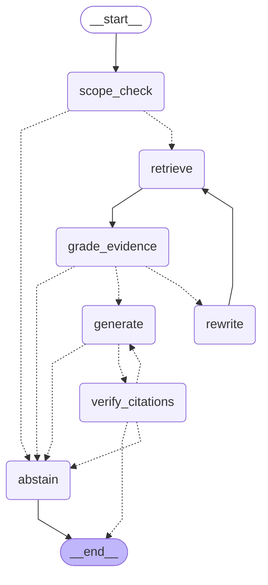
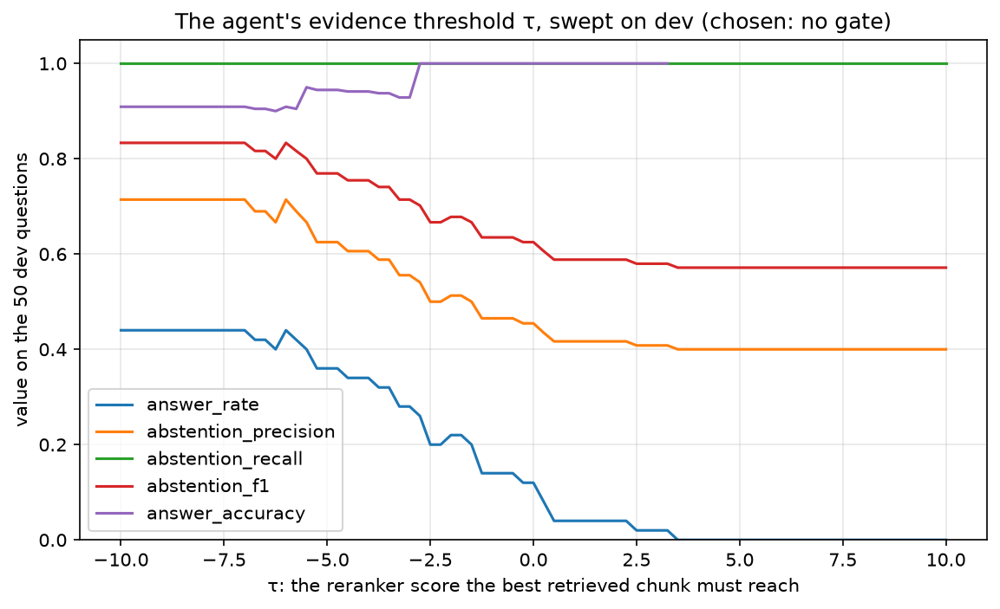

# Phase 5: A LangGraph agent, and whether it earns its keep

## The short version

- **The agent didn't earn its complexity.** The rule we wrote down before the sweep picked no gate, and there the agent behaved exactly like the Phase 4 pipeline. It gave the same 22 answers word for word, both have abstention F1 0.833, and every paired difference is 0. It made 1.92 model calls per question instead of 1, and took 16,748 ms at p50 instead of 9,559 ms.
- **The evidence gate never helped.** The pipeline already refused all 20 unanswerable dev questions, so abstention recall was 1.000 at every τ, and there was nothing left to gain on that side. On the answerable side, the rewrites a gate triggers fixed some refusals, but at every τ the agent also refused at least as many questions it had answered correctly. F1 never went above 0.833, and it fell to 0.571 once τ blocked everything.
- **The gate measured the wrong thing.** It asks "is the best chunk relevant?" But the pipeline's wrong refusals had relevant chunks with the important part missing: an enhancement without its base control. The 8 questions the pipeline wrongly refused had evidence scores from −6.19 to −0.24 (median −2.66). That's right among the 22 it answered (median −2.58), so no τ can pull them apart.
- **The small retrieval fix won.** Putting each enhancement's base control text into the context raised abstention F1 to 0.952 [0.865, 1.000]. On the same questions, that's +0.119 [+0.040, +0.219] over the pipeline. It fixed 6 of the 8 wrong refusals, answered all 6 correctly, broke nothing, and still refused all 20 unanswerable questions. By the rule we set beforehand, it's the system to ship.
- **The rewrites weren't useless, but they ran at the wrong times.** At some τ values they led to correct answers for q025 (MFA) and q036 (backup power), the two refusals base text couldn't fix. But a τ high enough to send those questions to a rewrite also refused others, so F1 never rose.

Every number below comes from `results/agent_dev.json` or `results/threshold_sweep.json`, and `make docs` regenerates the tables.

## What we built

| File | What it is |
|---|---|
| `src/controlfinder/agent/state.py` | The state every node reads and updates: a `TypedDict` with the fields AGENTS.md lists, plus a few the edges need |
| `src/controlfinder/agent/prompts.py` | The scope-check, rewrite and retry prompts, and the code that reads their replies |
| `src/controlfinder/agent/graph.py` | The LangGraph graph: seven nodes, the edges between them with both loop bounds, and the trace |
| `src/controlfinder/retrieval/production.py` | The production retriever, shared by the pipeline, the agent and Phase 6's API, plus the base-text variant |
| `src/controlfinder/generation/judge.py` | Gains the pairwise prompt, for comparing two answers |
| `src/controlfinder/eval/bootstrap.py` | Gains `paired_resample_ci()`: an interval for the difference between two systems on the same questions |
| `src/controlfinder/eval/agent.py` | `make agent-eval`: sweeps τ, compares three systems, judges pairs of answers, writes `query_log` and the results |
| `results/threshold_sweep.json`, `results/threshold_sweep.png` | The agent's dev metrics at every τ, and their plot |
| `results/agent_dev.json` | The three systems' metrics, the paired differences, the pick, the costs, and every question's row and trace |
| `tests/test_agent.py` | 31 tests, run against a scripted fake model: every path through the graph, including the loop bound; the reply parsers; and the evaluation's rules |

## How it works

### Three systems, the same 50 dev questions

- **Pipeline:** Phase 4, unchanged. Retrieve 10 controls, make one Sonnet call, check the citations.
- **Pipeline + base text:** the same, except every enhancement in the context has its base control's own chunk placed in front of it. Phase 4 found that 7 of its 8 wrong refusals had only an enhancement of the gold control in the context. This row tests whether that small retrieval fix does the job before anything fancier does. Jude asked for it as a separate row.
- **Agent:** the LangGraph graph below, with the pipeline's retrieval and prompt inside it.

### The graph

<!-- BEGIN generated: agent_graph -->

<!-- END generated: agent_graph -->

LangGraph drew this from the compiled graph, so the picture can't drift from the code. Solid arrows are always taken. Dotted arrows are conditional edges, where a small function reads the state and names the next node.

1. **`scope_check`** asks Claude Haiku 5.5 one question: is this about security or privacy? `OUT_OF_SCOPE` sends the run straight to `abstain`, without retrieving anything. A reply with neither word counts as in scope, because the generator can still refuse later.
2. **`retrieve`** runs the production retriever on the latest query: exact dense search on strategy C, keeping the top 10 controls.
3. **`grade_evidence`** has the Phase 3 reranker score the *original* question against each of the 10 chunks, and keeps the best score.
4. **Its edge** compares that score with τ:
   - at τ or above, go to `generate`;
   - below τ with fewer than 2 rewrites made, go to `rewrite`;
   - otherwise, go to `abstain`.
5. **`rewrite`** asks Haiku for a new query in the catalog's formal wording, then goes back to `retrieve`. That's the graph's one loop.
6. **`generate`** is Phase 4's prompt and Sonnet call. A reply of `INSUFFICIENT_EVIDENCE` goes to `abstain`.
7. **`verify_citations`** checks, in code, that the answer cites at least one control and only controls from the context. If it fails, the run goes back to `generate` once, with a note naming the bad citations. If it fails again, it goes to `abstain`.
8. **`abstain`** returns no answer. It gives a reason, and the 3 best-scored controls the run saw, so the user has somewhere to start reading.

Why grade the original question and not the rewrite? If the grader scored the rewritten query, a rewrite could raise its own score just by borrowing the catalog's words, without the chunks getting any closer to what the user asked.

### What a run leaves behind: the trace

Every node adds one step to `trace`: its name, its time, and what it decided. Here are three real runs from dev:

<!-- BEGIN generated: example_traces -->
| Question | Node | ms | What the step recorded |
|---|---|---|---|
| q001: When an employee leaves the company, what should happen to their accounts and access? | `scope_check` | 6,774 | reply: IN_SCOPE; model: claude-haiku-5-5 |
|  | `retrieve` | 13 | query: "When an employee leaves the company, what should happen to their accounts and access?"; controls: PS-4, AC-2(3), PS-6(3), PS-5, IR-9(4), IA-2(5), MA-5(1), AU-11(1), AC-6(6), SI-12(3) |
|  | `grade_evidence` | 301 | top score: -2.58; tau: no gate; strong: True |
|  | `generate` | 13,191 | retry: False; model: claude-sonnet-5-5; input tokens: 4562; output tokens: 650 |
|  | `verify_citations` | 0 | citations: PS-4, AC-2(3), PS-6(3); invalid: none; ok: True |
| q005: Can employees use their personal phones to read work email? | `scope_check` | 6,113 | reply: IN_SCOPE; model: claude-haiku-5-5 |
|  | `retrieve` | 11 | query: "Can employees use their personal phones to read work email?"; controls: AC-19(4), AT-2(4), PT-5(1), SC-42(4), PS-4(2), AC-8, AC-20(5), AC-3(14), PS-6(3), AU-9(6) |
|  | `grade_evidence` | 436 | top score: -4.36; tau: no gate; strong: True |
|  | `generate` | 5,931 | retry: False; model: claude-sonnet-5-5; input tokens: 5191; output tokens: 19 |
|  | `abstain` | 0 | reason: generator_refused; closest: PS-4(2) (-4.36), AT-2(4) (-6.91), AU-9(6) (-8.37) |
| q085: Who invented the World Wide Web? | `scope_check` | 5,933 | reply: OUT_OF_SCOPE; model: claude-haiku-5-5 |
|  | `abstain` | 0 | reason: out_of_scope; closest: none |
<!-- END generated: example_traces -->

q005 shows the problem this phase was about. Its gold controls are AC-19 and AC-20. Retrieval found both, but only as the enhancements AC-19(4) and AC-20(5), and the generator refused. Its three "closest" controls show the reranker's view of the same chunks. All three are wrong for the question, which is a fair warning about how much those suggestions can be trusted.

The chosen τ's 50 traces are also stored in Postgres. `make agent-eval` writes them to `query_log` under the pipeline name `agent/eval-dev`. It's the same table Phase 6's API will write to.

### The loop bound lives in an edge

```93:96:src/controlfinder/agent/graph.py
    def after_grade(self, state: State) -> str:
        if state["top_score"] >= self.gate:
            return "generate"
        return "rewrite" if state["attempts"] < MAX_REWRITES else "abstain"
```

`rewrite` adds 1 to `attempts`, and this function refuses to route to `rewrite` once `attempts` reaches `MAX_REWRITES`, which is 2. The generation retry is bounded the same way, in `after_verify`, by `MAX_GENERATIONS`. So the longest possible run is 14 steps:

1. the scope check;
2. three rounds of retrieve and grade, with a rewrite between them;
3. two rounds of generate and verify;
4. the abstention.

The test that proves it:

```49:56:tests/test_agent.py
def test_the_loop_stops_after_two_rewrites_when_the_evidence_stays_weak(tmp_path):
    state = Agent(make_tools(tmp_path, Script(), grade=scores(-9.0)), tau=0.0).run(QUESTION.question)
    assert nodes(state) == ["scope_check", "retrieve", "grade_evidence", "rewrite", "retrieve", "grade_evidence",
                            "rewrite", "retrieve", "grade_evidence", "abstain"]
    assert state["decision"] == "abstain" and state["reason"] == "weak_evidence" and state["answer"] is None
    assert state["attempts"] == MAX_REWRITES
    assert state["queries_tried"] == [QUESTION.question, "rewritten query 1", "rewritten query 2"]
    assert [c.control_id for c in state["closest"]] == ["ac-2", "sc-7"]
```

The fake grader scores every chunk −9 and τ is 0, so the evidence is never good enough. The run still ends, after exactly 2 rewrites, at `abstain` with the reason `weak_evidence`.

### Sweeping τ

The sweep ran the agent on all 50 dev questions at 82 values of τ: no gate, then −10 to 10 in steps of 0.25. Every first evidence score on dev fell between −8.89 and 3.36 (see below), well inside that range.

This is cheap because every model call and reranker score is cached. A τ that needs only calls already made costs almost nothing, and the whole sweep replays from the cache without calling any model.

<!-- BEGIN generated: tau_sweep -->
| τ | Answer rate | Abstention precision | Abstention recall | Abstention F1 | Answer accuracy | LLM calls per question | Rewritten / then answered / correctly |
|---|---|---|---|---|---|---|---|
| **no gate (chosen)** | 0.440 | 0.714 | 1.000 | 0.833 | 0.909 | 1.92 | 0 / 0 / 0 |
| -10.00 to -9.00 | 0.440 | 0.714 | 1.000 | 0.833 | 0.909 | 1.92 | 0 / 0 / 0 |
| -8.75 | 0.440 | 0.714 | 1.000 | 0.833 | 0.909 | 1.94 | 1 / 0 / 0 |
| -8.50 | 0.440 | 0.714 | 1.000 | 0.833 | 0.909 | 1.98 | 2 / 0 / 0 |
| -8.25 to -8.00 | 0.440 | 0.714 | 1.000 | 0.833 | 0.909 | 1.98 | 3 / 0 / 0 |
| -7.75 | 0.440 | 0.714 | 1.000 | 0.833 | 0.909 | 2.06 | 6 / 0 / 0 |
| -7.50 | 0.440 | 0.714 | 1.000 | 0.833 | 0.909 | 2.08 | 6 / 0 / 0 |
| -7.25 | 0.440 | 0.714 | 1.000 | 0.833 | 0.909 | 2.08 | 7 / 1 / 1 |
| -7.00 | 0.440 | 0.714 | 1.000 | 0.833 | 0.909 | 2.10 | 8 / 2 / 2 |
| -6.75 | 0.420 | 0.690 | 1.000 | 0.816 | 0.905 | 2.14 | 10 / 2 / 2 |
| -6.50 | 0.420 | 0.690 | 1.000 | 0.816 | 0.905 | 2.18 | 12 / 2 / 2 |
| -6.25 | 0.400 | 0.667 | 1.000 | 0.800 | 0.900 | 2.16 | 12 / 1 / 1 |
| -6.00 | 0.440 | 0.714 | 1.000 | 0.833 | 0.909 | 2.20 | 14 / 3 / 3 |
| -5.75 | 0.420 | 0.690 | 1.000 | 0.816 | 0.905 | 2.26 | 16 / 3 / 3 |
| -5.50 | 0.400 | 0.667 | 1.000 | 0.800 | 0.950 | 2.34 | 19 / 3 / 3 |
| -5.25 | 0.360 | 0.625 | 1.000 | 0.769 | 0.944 | 2.32 | 19 / 1 / 1 |
| -5.00 to -4.75 | 0.360 | 0.625 | 1.000 | 0.769 | 0.944 | 2.30 | 19 / 1 / 1 |
| -4.50 | 0.340 | 0.606 | 1.000 | 0.755 | 0.941 | 2.36 | 22 / 1 / 1 |
| -4.25 to -4.00 | 0.340 | 0.606 | 1.000 | 0.755 | 0.941 | 2.38 | 23 / 1 / 1 |
| -3.75 | 0.320 | 0.588 | 1.000 | 0.741 | 0.938 | 2.40 | 24 / 1 / 1 |
| -3.50 | 0.320 | 0.588 | 1.000 | 0.741 | 0.938 | 2.42 | 25 / 1 / 1 |
| -3.25 | 0.280 | 0.556 | 1.000 | 0.714 | 0.929 | 2.44 | 26 / 0 / 0 |
| -3.00 | 0.280 | 0.556 | 1.000 | 0.714 | 0.929 | 2.48 | 28 / 1 / 1 |
| -2.75 | 0.260 | 0.540 | 1.000 | 0.702 | 1.000 | 2.52 | 30 / 1 / 1 |
| -2.50 to -2.25 | 0.200 | 0.500 | 1.000 | 0.667 | 1.000 | 2.56 | 32 / 0 / 0 |
| -2.00 | 0.220 | 0.513 | 1.000 | 0.678 | 1.000 | 2.60 | 34 / 1 / 1 |
| -1.75 | 0.220 | 0.513 | 1.000 | 0.678 | 1.000 | 2.62 | 35 / 2 / 2 |
| -1.50 | 0.200 | 0.500 | 1.000 | 0.667 | 1.000 | 2.66 | 37 / 2 / 2 |
| -1.25 to -0.50 | 0.140 | 0.465 | 1.000 | 0.635 | 1.000 | 2.70 | 39 / 1 / 1 |
| -0.25 | 0.120 | 0.455 | 1.000 | 0.625 | 1.000 | 2.72 | 40 / 1 / 1 |
| 0.00 | 0.120 | 0.455 | 1.000 | 0.625 | 1.000 | 2.74 | 41 / 1 / 1 |
| 0.25 | 0.080 | 0.435 | 1.000 | 0.606 | 1.000 | 2.76 | 42 / 0 / 0 |
| 0.50 to 2.25 | 0.040 | 0.417 | 1.000 | 0.588 | 1.000 | 2.80 | 44 / 0 / 0 |
| 2.50 to 3.25 | 0.020 | 0.408 | 1.000 | 0.580 | 1.000 | 2.82 | 45 / 0 / 0 |
| 3.50 to 10.00 | 0.000 | 0.400 | 1.000 | 0.571 | undefined | 2.84 | 46 / 0 / 0 |
<!-- END generated: tau_sweep -->

Neighbouring τ values with identical results share a row. The last column gives three counts:
- the questions sent to `rewrite` at least once;
- how many of those were then answered;
- how many of those answers were correct.



### Picking τ

The rule was in `DECISIONS.md` before the sweep ran: the highest dev abstention F1, with ties going to the lowest τ, and no gate counting as lowest of all. Jude chose F1 because it counts a wrong refusal and a made-up answer as equally bad.

The top F1, 0.833, was shared by three settings: no gate, every τ from −10.00 to −7.00, and −6.00. So the rule picks no gate.

A tied F1 doesn't mean the same behaviour. At −6.00, 14 questions went to `rewrite` and 3 of them ended with correct answers. Yet the answer rate matches no gate's 0.440, because the gate also stopped questions that no gate answers.

### What the rewrites did

The table lists every question the agent answered only after a rewrite, at any τ:

<!-- BEGIN generated: rewrite_answers -->
| ID | Question | Pipeline | τ values where a rewrite led to an answer | Answer correct? |
|---|---|---|---|---|
| q016 | Who should formally approve a new system going live from a security point of view? | answered, correct | -7.00 to -5.50 | yes |
| q017 | What does CM-8 expect our asset inventory to include? | refused | -2.00 to 0.00 | yes |
| q025 | Should we require MFA for employees? | refused | -6.00 to -5.50 | yes |
| q029 | What steps should we follow when we detect a security incident? | answered, correct | -1.75 to -1.50 | yes |
| q034 | Should we restrict the use of USB drives? | answered, correct | -3.00 to -2.75 | yes |
| q035 | How should we control who can enter our server room? | answered, correct | -7.25 to -6.50 | yes |
| q036 | Do our servers need backup power? | refused | -6.00 to -3.50 | yes |
<!-- END generated: rewrite_answers -->

The rewrites never produced a wrong answer. Three of these questions were ones the pipeline had refused, including q025 and q036, which base text couldn't fix either. Rewriting helps when the user's words don't match the catalog's. Haiku turned "Should we require MFA for employees?" into "multi-factor authentication for organizational users". It turned "Do our servers need backup power?" into "Alternative power source…" and then "Emergency power…", and PE-11's title is Emergency Power. The replies are in `data/cache/llm.jsonl`.

The trouble is the trigger. A rewrite happens only when the reranker score is below τ, and any τ high enough to catch these questions also stops answerable questions that were fine.

## Results on dev

### Side by side

<!-- BEGIN generated: system_metrics -->
| Dev metric [95% CI] | Pipeline | Pipeline + base text | Agent |
|---|---|---|---|
| TP / FP / FN / TN | 20 / 8 / 0 / 22 | 20 / 2 / 0 / 28 | 20 / 8 / 0 / 22 |
| `abstention_precision` | 0.714 [0.542, 0.864] | 0.909 [0.762, 1.000] | 0.714 [0.542, 0.864] |
| `abstention_recall` | 1.000 [1.000, 1.000] | 1.000 [1.000, 1.000] | 1.000 [1.000, 1.000] |
| `abstention_f1` | 0.833 [0.703, 0.927] | 0.952 [0.865, 1.000] | 0.833 [0.703, 0.927] |
| `answer_rate` | 0.440 [0.300, 0.580] | 0.560 [0.420, 0.700] | 0.440 [0.300, 0.580] |
| `citation_precision` | 1.000 [1.000, 1.000] | 1.000 [1.000, 1.000] | 1.000 [1.000, 1.000] |
| `gold_citation_recall` | 0.864 [0.722, 0.974] | 0.893 [0.776, 0.982] | 0.864 [0.722, 0.974] |
| `answer_accuracy` | 0.909 [0.773, 1.000] | 0.929 [0.821, 1.000] | 0.909 [0.773, 1.000] |
| `faithfulness` | 5.000 [5.000, 5.000] | 5.000 [5.000, 5.000] | 5.000 [5.000, 5.000] |
| `gold_in_context` | 0.900 [0.788, 1.000] | 0.900 [0.788, 1.000] | 0.900 [0.788, 1.000] |
<!-- END generated: system_metrics -->

The pipeline column reproduces Phase 4's numbers exactly, which checks that the refactor into a shared retriever changed nothing. Faithfulness is 5.000 for every answer of every system. With base text, the model answered more questions and still stuck to its context.

### Paired differences

<!-- BEGIN generated: versus_pipeline -->
| Metric | Pipeline + base text minus pipeline [95% CI] | Agent minus pipeline [95% CI] |
|---|---|---|
| `abstention_f1` | +0.119 [+0.040, +0.219] | +0.000 [+0.000, +0.000] |
| `answer_rate` | +0.120 [+0.040, +0.220] | +0.000 [+0.000, +0.000] |
| `answer_accuracy` | +0.019 [+0.000, +0.061] | +0.000 [+0.000, +0.000] |
| `faithfulness` | +0.000 [+0.000, +0.000] | +0.000 [+0.000, +0.000] |
<!-- END generated: versus_pipeline -->

These intervals come from resampling the questions with both systems in each resample. The 50 questions vary a lot in difficulty, and a paired comparison removes that shared variation. It asks only how the two systems differ on the same questions. Base text's F1 gain has an interval that excludes 0. The agent's differences are exactly 0 in every resample, because it never once ended a question differently.

### Which one ships

<!-- BEGIN generated: agent_pick -->
| System, simplest first | Abstention F1 | Minus the best's [95% CI] | Within noise of the best? |
|---|---|---|---|
| Pipeline | 0.833 | -0.119 [-0.219, -0.040] | no |
| **Pipeline + base text (pick)** | 0.952 | +0.000 [+0.000, +0.000] | best |
| Agent | 0.833 | -0.119 [-0.219, -0.040] | no |
<!-- END generated: agent_pick -->

The rule, also written down before the run, picks the simplest system whose F1 isn't distinguishably below the best. The order from simplest is: pipeline, then pipeline + base text, then agent. The pipeline is distinguishably worse, so the pick is the pipeline with base text.

### Every question that changed

<!-- BEGIN generated: decision_moves -->
| Questions | Change from the pipeline | Pipeline + base text | Agent |
|---|---|---|---|
| answerable | refused → answered | 6 | 0 |
| answerable | answered → refused | 0 | 0 |
| unanswerable | refused → answered | 0 | 0 |
| unanswerable | answered → refused | 0 | 0 |
<!-- END generated: decision_moves -->

<!-- BEGIN generated: changed_questions -->
| ID | Question | Kind | Pipeline | Pipeline + base text | Agent |
|---|---|---|---|---|---|
| q005 | Can employees use their personal phones to read work email? | answerable | refused | answered, correct | refused (generator refused) |
| q011 | How long should we keep audit logs? | answerable | refused | answered, correct | refused (generator refused) |
| q017 | What does CM-8 expect our asset inventory to include? | answerable | refused | answered, correct | refused (generator refused) |
| q042 | What background checks should we run on new hires? | answerable | refused | answered, correct | refused (generator refused) |
| q046 | How often should we scan our systems for vulnerabilities? | answerable | refused | answered, correct | refused (generator refused) |
| q057 | What anti-malware protection do we need? | answerable | refused | answered, correct | refused (generator refused) |
<!-- END generated: changed_questions -->

Base text fixed 6 of the pipeline's 8 wrong refusals. The two it didn't fix fail for different reasons:

- **q025, "Should we require MFA for employees?"** IA-2's own text was in the context this time, but it mentions multi-factor authentication only as one way to authenticate. The requirement to use it is in the enhancements IA-2(1) and IA-2(2), which weren't retrieved. Refusing is defensible.
- **q036, "Do our servers need backup power?"** PE-11, the gold control, was never retrieved. The search brought back data-backup controls like CP-9, as in Phase 4.

### How the agent's runs went

<!-- BEGIN generated: agent_paths -->
| How the agent's runs went (dev) | Questions |
|---|---|
| Refused: the scope check said off-topic | 4 |
| Refused: evidence still below τ after 2 rewrites | 0 |
| Refused: the generator replied INSUFFICIENT_EVIDENCE | 24 |
| Refused: the citations failed the check twice | 0 |
| Answered after 0 rewrites | 22 |
| Answered after 1 rewrite | 0 |
| Answered after 2 rewrites | 0 |
| Questions rewritten at least once | 0 |
| Answers retried after failing the citation check | 0 |
<!-- END generated: agent_paths -->

With no gate, nothing is ever rewritten, and no answer failed the citation check, so the retry never ran. The scope check stopped the 4 trivia questions, which the generator would have refused anyway, as it did in Phase 4.

### Why the gate couldn't help

<!-- BEGIN generated: first_evidence_scores -->
| Dev questions | Questions | Scored (not stopped as off-topic) | Lowest | Median | Highest |
|---|---|---|---|---|---|
| Answerable, answered by the pipeline | 22 | 22 | -7.37 | -2.58 | 3.36 |
| Answerable, refused by the pipeline | 8 | 8 | -6.19 | -2.66 | -0.24 |
| Unanswerable | 20 | 16 | -8.89 | -6.68 | -2.79 |
<!-- END generated: first_evidence_scores -->

Unanswerable questions do score lower, with a median of −6.68. But the generator already refuses all of them, so the gate adds nothing there.

The questions the gate would need to catch are the 8 answerable ones the pipeline refused. Their scores (median −2.66) look just like those of the questions answered correctly (median −2.58). The reranker judges whether a chunk is *about* the question, and an enhancement of the right control is about the question. What was missing was the base text, and a relevance score can't see that.

### Pairwise judging had nothing to judge

<!-- BEGIN generated: pairwise_results -->
| Both answered | Identical answers (ties, not judged) | Agent wins | Pipeline wins | Ties | Orders disagreed | Unreadable verdicts |
|---|---|---|---|---|---|---|
| 22 | 22 | 0 | 0 | 22 | 0 | 0 |
<!-- END generated: pairwise_results -->

The design is to judge both orders and count a win only when both agree. It's tested, but it never ran on real answers, because the agent's 22 answers were word for word the pipeline's. Calling a judge on two identical answers would measure only the judge's noise, so identical answers count as ties without a call.

### What it costs

<!-- BEGIN generated: system_costs -->
| System | LLM calls per question: mean (max) | Latency per question, p50 / p95 (ms) |
|---|---|---|
| Pipeline | 1.00 (max 1) | 9,559 / 13,675 |
| Pipeline + base text | 1.00 (max 1) | 10,207 / 14,468 |
| Agent | 1.92 (max 2) | 16,747 / 21,423 |
<!-- END generated: system_costs -->

<!-- BEGIN generated: agent_step_costs -->
| Agent node | Steps run on dev | Time per step, p50 / p95 (ms) |
|---|---|---|
| `scope_check` | 50 | 6,575 / 9,124 |
| `retrieve` | 46 | 11 / 12 |
| `grade_evidence` | 46 | 478 / 536 |
| `generate` | 46 | 9,596 / 13,689 |
| `verify_citations` | 22 | 0 / 0 |
| `abstain` | 28 | 0 / 0 |
<!-- END generated: agent_step_costs -->

The agent's extra time is almost all the scope check. Through the Cursor SDK every call starts an agent, so even Haiku's one-word reply took 6,575 ms at p50. The reranker adds 478 ms. Base text makes the prompt longer, and its p50 is 10,206 ms against the pipeline's 9,559 ms.

## Concepts

### What LangGraph adds over a plain chain of functions

**The simple version.** A chain of functions is a recipe: step 1, then 2, then 3, always in that order. A graph is a board game. Each square says where you may go next, depending on what's happened so far. One path loops back, and the rules say you can only go around it twice. And you keep a diary of every square you landed on.

**More precisely, it gives four things:**

- **Explicit state.** One typed dictionary holds everything the run knows, like the question, the queries tried, the best score and the answer. Each node gets the state and returns only the fields it changed. Reducers say how changes combine: `queries_tried` and `trace` are appended to, never overwritten.
- **Conditional edges.** The decision "where next?" is a small function of the state, kept apart from the work each node does. `after_grade` is four lines, and we can read it and test it on its own.
- **Cycles.** `rewrite → retrieve → grade_evidence` is a loop in the graph. In a plain function it would be a `while` loop buried in the middle of the code.
- **An inspectable trace.** Every run records its path, so "why did it refuse?" has an answer you can read. LangGraph can also draw the graph from the code, as above.

**The honest part.** This agent could also be about 40 lines of plain Python with a `for` loop and some `if`s. LangGraph's value grows with things we didn't use:
- checkpoints that save the state between steps;
- pausing for a human to approve a step;
- streaming steps as they happen;
- graphs with many more branches.

For seven nodes, its main gift here was structure we could draw, trace and test.

### Why the loop bound belongs in the graph's structure

**The simple version.** "Please don't ask more than twice" is a request. A door that locks after the second try is a rule.

If the bound lives in a prompt, like "rewrite at most twice", the model can ignore it, miscount, or be talked out of it by the text it's reading. In the edge function, the bound is code. The count is in the state, and the edge won't route to `rewrite` once it reaches 2. That gives three things:
- **It always holds.** No model output can make a third rewrite happen.
- **It's testable.** The termination test above uses a grader that never passes.
- **It's visible.** Anyone reading the graph sees every way out of the loop.

LangGraph has its own backstop too: a run that takes more than 25 steps by default raises an error. But that's a crash, not a design. Our bound ends the run on purpose, with an abstention and a reason, after at most 14 steps.

### Abstention is a precision/recall tradeoff, not one number

**The simple version.** A goalkeeper who dives at every shot stops more goals, but also dives when nobody kicked. Raising τ is telling the system to dive more often.

Each refusal is a prediction that a question can't be answered. Raising τ makes the system refuse more, and the sweep shows the price of every step:

- **Answer accuracy goes up.** From τ = −2.75 on, every answer it gave was correct (1.000).
- **But the answer rate falls,** to 0.260 at −2.75. A tool that answers a quarter of the questions is a tool people stop using.
- **And abstention precision falls,** because more and more of the refusals are answerable questions.

One number hides which side you're paying on. That's why the sweep reports all of them, and why we wrote down the rule for choosing before seeing the curve. Here, recall was 1.000 at every τ, so the curve could only move along precision. In most products, both would move.

### Guardrails and constraint spaces

AI job descriptions often ask for "guardrails" and "constraint spaces". This phase is a small, concrete example of both.

**Guardrails are checks around a model that limit what it can take in, do and say.**

| Kind | Here |
|---|---|
| Input | The scope check refuses off-topic questions before any retrieval |
| Output | The citation check in code; the refusal word; answers only from the given controls |
| Process | The loop bounds; models with no tools, run in an empty folder |
| Safe failure | A structured abstention with a reason and the closest controls, instead of a guess |

**A constraint space is the set of things the system is allowed to do.** Our agent can only take the seven nodes' actions, along the drawn edges, with at most 2 rewrites and 2 generations. It can't browse or call tools, and it can't cite a control it wasn't given. An agent whose LLM freely chooses its next action can do anything its tools allow. Ours can only do what the graph allows, which makes it auditable.

**Guardrails need evaluation too.** This phase measured each guardrail's cost against what it caught:
- The scope check stopped 4 questions the generator would have refused anyway, and cost 6,575 ms at p50 on every question.
- The citation check never failed.

A guardrail you can't measure is a guess about safety.

### When does an agent earn its complexity?

It has to beat the simplest system on the metric that matters, by more than noise, at a cost you'd pay. Ours didn't. At the chosen τ it was identical, and at the other values of τ it was worse. It also cost almost twice the model calls and 7 more seconds at p50.

The bigger lesson is to **diagnose before you build**. Phase 4's `gold_coverage` field had already shown the failure: missing base text. The fix for that was a few lines in retrieval. The agent's gate measured a different thing, relevance, so it couldn't target the failure.

The sweep does suggest one thing worth testing next: **rewrite when the generator refuses, not when the reranker score is low**. That would send exactly the refused questions, like q025 and q036, to a rewrite, and leave the answered ones alone. It's untested, and it would have to earn its place by the same rules.

## What this means for Phase 6

- **What ships:** the pipeline with base text. It's the production pick on dev.
- **The sealed test run:** Phase 6 runs every final configuration on test once. We'll decide which configurations count as final before unsealing: at least the pick, and probably the pipeline and the agent too, so the test results can confirm or contradict this comparison.
- **The app:** the ask page should use the pick, and the trace page shows the agent's steps. How the two fit together in `/ask` is a Phase 6 decision for Jude.

## Decisions

Each of these has a row in `DECISIONS.md`. Everything up to and including the comparison rule was committed before the agent's first run on the QA set.

- **Models:** Claude Haiku 5.5 for the scope check and the rewrites, Claude Sonnet 5.5 for answers, and GPT-5.6 Sol as the judge, so the judge's model family differs from every model that shapes an answer.
- **The graph follows AGENTS.md:**
  - at most 2 rewrites, checked in the edge;
  - at most 2 generations, the answer and one retry that names the bad citations;
  - an uncited answer fails the check;
  - an unreadable scope reply counts as in scope;
  - an abstention reports its reason and the 3 closest controls.
- **The evidence grade** is the reranker's best score for the original question against the 10 chunks. The τ grid is no gate, then −10 to 10 in steps of 0.25.
- **The τ rule** (pre-registered definition 9) is the highest dev abstention F1, with ties going to the lowest τ. The result was no gate.
- **The new prompts were fixed before the first run,** and their hashes are saved in the results. None quotes a QA question.
- **Pipeline + base text** is a separate third system, added at Jude's request.
- **Comparisons are paired bootstrap intervals over the 50 questions.** Production is the simplest system within noise of the best, and that's pipeline + base text.
- **Pairwise judging** covers questions both systems answered. It runs both orders, counts identical answers as ties without a call, and shows the same controls in both orders.
- **Costs:** latency is the sum of each step's time, using the original call times from the cache. Model calls count every scope check, rewrite and generation.
- **Added after the sweep, labelled as such:**
  - the counts of rewritten questions per τ, with which questions were answered after a rewrite;
  - every system's gap to the best;
  - the first evidence scores by group;
  - each node's time.

  None of these changed a rule or a pick.

## Gotchas we hit

1. **A network error stopped the first full run near the end.** The Cursor API returned "Network request failed" during a judge call. Every call had been cached as it went, so the rerun replayed the whole sweep without a single model call and carried on from where it stopped.
2. **The progress print said the agent refused everything.** The agent's rows were all there from the start, while the other two systems' rows grew one question at a time. So `rows[s][-1]` meant "this question" for those two, but "the last question" for the agent. The data was fine and the print was wrong. When a result looks too bad to be true, check the reporting before the system.
3. **A grader can be gamed by its own input.** Scoring the rewritten query would let a rewrite raise its own score with catalog vocabulary. The grader always scores the original question.
4. **A cheap model isn't cheap through an agent SDK.** Haiku's one-word scope verdict took 6,575 ms at p50, because each call starts a Cursor agent. The "cheap scope check" in the spec assumed a direct API call.
5. **Equal scores can hide different behaviour.** τ = −6.00 tied no gate's F1 while sending 14 questions to `rewrite`. Only the per-τ counts showed the difference.
6. **"Reply with the query only" isn't a guarantee.** For q017, Haiku's first rewrite opened with a sentence about what it was doing, and the parser takes the first line, so that sentence became the query. It still found CM-8, because the sentence named the control's title, System Component Inventory. A stricter parser, or a model call with a fixed output format, would make this safer.
7. **Sharing code across phases breaks old tests.** Moving retrieval into `production.py` changed the context's type, and a Phase 4 test broke. The full test suite caught it before the commit.

## Interview questions

**1. What does LangGraph give you over a plain chain of functions?**
It gives four things: explicit typed state, routing written as small functions of that state, loops written as edges, and a trace of every step. In my agent, the only loop is rewrite → retrieve → grade, and its bound is a four-line edge function I can unit test. The trace stores each node's decision and time, and LangGraph draws the graph from the code. To be honest, a seven-node agent could be 40 lines of plain Python. LangGraph's bigger features, like checkpoints, human approval steps and streaming, are things I didn't need here.

**2. How do you guarantee your agent loop terminates?**
The bound is in the graph, not in a prompt. The rewrite node adds 1 to an attempts counter in the state, and the edge after grading won't route to rewrite once attempts reaches 2. It goes to abstain instead. Citation retries are bounded the same way, so the longest possible run is 14 steps. A unit test uses a grader that always scores below τ and asserts the exact path: two rewrites, then an abstention with the reason weak_evidence.

**3. How did you pick the evidence threshold?**
I swept τ on dev only, at 82 values from no gate up to 10, and wrote the selection rule in DECISIONS.md before the sweep ran. The rule was the highest abstention F1, with ties going to the lowest τ. The best F1, 0.833, was tied between no gate and several low thresholds, so the rule picked no gate. Raising τ always bought answer accuracy, up to 1.000, but at the cost of answer rate, which was 0.260 at τ = −2.75. Recall was already 1.000, so F1 only fell.

**4. Did the agent beat the plain pipeline?**
No. At the chosen τ, it gave the same 22 answers word for word and had the same abstention F1, 0.833. It cost 1.92 model calls per question instead of 1, and 16,748 ms at p50 instead of 9,559 ms, almost all of that from the scope check. What did win was a small retrieval fix: adding each enhancement's base control text. That got F1 to 0.952, and the paired difference was +0.119 [+0.040, +0.219]. So that's what ships, and I report the agent as a negative result.

**5. Why didn't the evidence gate help?**
Two reasons. First, the pipeline already refused all 20 unanswerable dev questions, so every refusal a gate added was a wrong one. Second, the gate measures relevance, but the wrong refusals came from relevant chunks that were missing the base control's text. The 8 wrongly refused questions scored a median of −2.66, while the 22 correctly answered ones scored −2.58, so no τ separates them. Rewrites did fix q025 and q036 at some τ values, but the same τ blocked good answers elsewhere.

**6. Why is abstention a precision/recall tradeoff?**
Each refusal is a prediction that the question can't be answered, so you can count right and wrong refusals like any classifier. Raising the threshold makes the system refuse more. In my sweep, answer accuracy rose to 1.000 while the answer rate fell to 0.260 and abstention precision fell to 0.540. One number hides which way you're paying. So I report precision, recall, answer rate and accuracy at every τ, and I chose the operating point by a rule I wrote down in advance.

**7. How do you compare two systems fairly on only 50 questions?**
With a paired bootstrap. I resample the questions 1,000 times, score both systems on the same resample, and take the difference, which cancels out how hard each question is. Base text minus pipeline on F1 was +0.119, with a 95% interval of [+0.040, +0.219] that excludes 0. For answer quality, I'd judge pairs of answers in both orders and count a win only when both orders agree, to cancel position bias. Here all 22 answers were identical, so there was nothing to judge.

**8. What guardrails does your system have?**
- **Input:** a scope check that refuses off-topic questions before retrieval.
- **Output:** a citation check in plain code, plus a fixed refusal word.
- **Process:** loop bounds in the graph, and models that run with no tools in an empty folder.
- **Safe failure:** a structured abstention with its reason and the closest controls.

I measured each one, too. The scope check caught only the 4 trivia questions, which the generator would have refused anyway, and cost 6,575 ms at p50. The citation check didn't fail a single answer on dev.

## Follow-ups from the quiz

Jude asked what τ is before the first question, and then for all three questions with their answers, instead of answering them. He found the first answers too vague, so these are the concrete versions, starting with the terms they rely on.

**What are the three systems? One question through each.**
q005, "Can employees use their personal phones to read work email?" Its gold controls are AC-19 Access Control for Mobile Devices and AC-20 Use of External Systems.
- **Plain pipeline (Phase 4):** search the catalog for 10 controls, then make one Claude Sonnet 5.5 call with the question, the 10 controls and the rules (answer only from these, cite every claim, or reply `INSUFFICIENT_EVIDENCE`). For q005 the 10 included AC-19(4) Restrictions for Classified Information and AC-20(5) Portable Storage Devices — Prohibited Use. Those are narrow enhancements, without AC-19's or AC-20's own text, and Sonnet replied `INSUFFICIENT_EVIDENCE`.
- **Pipeline + base text:** the same, except code places each enhancement's base control text in front of it, so AC-19's and AC-20's own text joined the context. Sonnet answered "The controls leave this to the organization", explaining that it can allow personal devices under terms it sets or prohibit them, citing AC-19 and AC-20. Correct.
- **Agent:** Haiku's scope check replied `IN_SCOPE`. The search was the same. The reranker's best score was −4.36, for PS-4(2) Automated Actions, a personnel-termination enhancement. With no gate that passes, so Sonnet got the same 10 controls and refused again: two model calls instead of one, for the same result.

**What does a score like −2.66 mean?**
The reranker (bge-reranker-base) reads the question and one chunk together and outputs one number: the higher it is, the better the match. The number has no unit. It isn't a percentage, and a negative score isn't bad by itself; it's only useful for comparing. A question's evidence score is the best of its 10 chunks' scores. −2.66 is the median, the middle value, of the evidence scores of the 8 answerable questions the pipeline wrongly refused, and −2.58 is the median for the 22 it answered. Sorted by score, the refused questions sit among the answered ones. The server-room question, q035, had the lowest score of any answerable question, −7.37, and was answered correctly; the vulnerability-scanning question, q046, scored −0.24 and was refused.

**Where are the LLMs?**
Three models write text. Claude Sonnet 5.5 writes every answer, in all three systems. Claude Haiku 5.5 does the agent's scope check and its rewrites. GPT-5.6 Sol judges answers, during evaluation only. Search (bge-small-en-v1.5 embeddings in pgvector), the evidence score (bge-reranker-base, which outputs a number and can't write), adding base text and checking citations aren't LLMs. Both pipelines make 1 model call per question. The agent makes between 1 and 5: a scope check, up to 2 rewrites and up to 2 answers. On dev it averaged 1.92: 50 scope checks and 46 answers, because the 4 trivia questions stopped at the scope check.

**What is τ, in plain words?**
τ (the Greek letter tau) is a pass mark. For each question, the reranker scores how well each of the 10 retrieved chunks matches it, and the best of those is the question's evidence score. If the evidence score is at least τ, the agent writes an answer. If not, it searches again with new words, at most twice, and then says "I don't know". "No gate" means no pass mark at all: every question goes to the generator, which can still refuse by itself, exactly as the Phase 4 pipeline does. The scores are on the reranker's own scale, where higher means a better match; on dev, first evidence scores ran from −8.89 to 3.36. Each row of the sweep table is one pass mark, with the agent's results on the 50 dev questions at that mark.

**1. We tried 82 values of τ, and none gave a higher abstention F1 than no gate. Why couldn't the gate help?**
The plain pipeline already refused all 20 unanswerable dev questions, so abstention recall was 1.000 with no gate and stayed 1.000 at every τ. Every refusal a gate adds is therefore of an answerable question, which lowers abstention precision and so F1. The only possible gain was fixing the 8 wrong refusals, through rewrites, and the gate couldn't aim at them: their scores sit among those of the questions answered correctly. To send all 8 to a rewrite, τ has to be above −0.24, and there the agent answered only 6 questions (answer rate 0.120). The best case shows the trade. At τ = −6.00, 14 questions were rewritten. The rewrites fixed q025 (MFA) and q036 (backup power), but q035 (the server room) and q039 (a CISO) scored below the line, weren't rescued by their rewrites, and ended up refused although no gate answers them correctly. Two fixed and two broken left 22 answers, 20 of them correct, and the same F1, 0.833.
*An interviewer would push on:* is a gate ever useful? Yes, when the generator answers questions it should refuse, so recall is below 1.000. Here the generator's own refusal already did that job.

**2. Where does the limit of two rewrites live, and why there and not in the rewrite prompt?**
In the edge function after `grade_evidence`, `after_grade`. The `rewrite` node adds 1 to `attempts` in the state, and once `attempts` reaches `MAX_REWRITES`, which is 2, the edge sends the run to `abstain` instead of `rewrite`. Haiku only writes the new search words; it never decides whether there's another round, and nothing it replies can change the counter. In code the bound always holds, because no model output can cause a third rewrite; a limit written in a prompt is a request the model can ignore or miscount. It's also testable: the termination test grades every chunk −9 with τ = 0 and asserts the exact path, two rewrites ending in `abstain` with the reason `weak_evidence`. LangGraph's default limit of 25 steps is only a backstop that raises an error; ours ends on purpose, with an abstention and a reason, after at most 14 steps.
*An interviewer would push on:* the other loop. The citation retry is bounded the same way, by `MAX_GENERATIONS` in `after_verify`.

**3. Base text scored F1 0.952 and the pipeline 0.833 on the same questions. Why use a paired bootstrap for the difference instead of comparing their two intervals?**
Both systems answered the same 50 questions, so their scores are linked: a question that's easy for one is usually easy for the other. Each system's own interval includes all of that question-to-question variation, and the two overlap, [0.703, 0.927] for the pipeline and [0.865, 1.000] for base text, which looks like "can't tell them apart". The paired bootstrap resamples the questions 1,000 times and scores both systems on each resample, so shared difficulty cancels and only the difference varies: +0.119 [+0.040, +0.219], which excludes 0. That fits what happened question by question. The two pipelines ended differently on only 6 of the 50 questions (q005, q011, q017, q042, q046 and q057), and each was a refusal that base text turned into a correct answer. Since base text was never worse on any question, a resample can only show it ahead or level, and it's level only when the resample misses all 6 questions, which almost never happens.
*An interviewer would push on:* 50 questions is small. The interval excludes 0 but is wide, from +0.040 to +0.219, and the sealed test set in Phase 6 is the real check.
